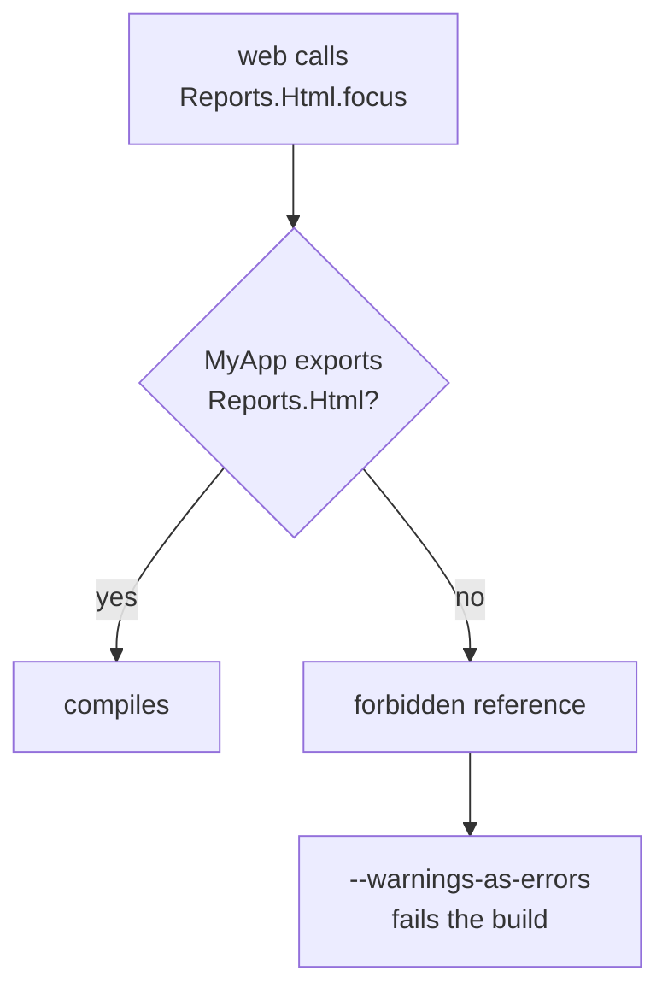

> [!TLDR]
> Phoenix contexts are a convention, so nothing stops other code from calling a context's internals. [`boundary`](https://github.com/sasa1977/boundary) is a library that checks at compile time which modules may call which. I added it to a Phoenix app, and a call from the web layer into a context's internals now fails the build. Most fixes were a choice of what to export. `boundary` misses a query on another context's table, so I moved those into the owner by hand.

[Phoenix contexts](https://hexdocs.pm/phoenix/contexts.html) group the modules for one part of an app behind a module of plain functions, like `MyApp.Reports`. Those functions are the context's API.

In the app, a web component called `MyApp.Reports.Html.focus/1`, an internal helper. A billing context filtered its invoices with `from u in User, where: u.email == ^email`, a query on the accounts context's table. A change inside reports or accounts then breaks code their owner never sees.

Full domain-driven design, with [bounded contexts](https://martinfowler.com/bliki/BoundedContext.html), was more than I needed. I wanted each context to have a clear API, and a build that fails when code goes around it.

## The checkers I weighed

| Option | What it does | Verdict |
| :-- | :-- | :-- |
| [`mix xref`](https://hexdocs.pm/mix/Mix.Tasks.Xref.html) | Reports the dependency graph | No rule per context |
| `credo`'s [`ForbiddenModule`](https://hexdocs.pm/credo/Credo.Check.Warning.ForbiddenModule.html) | Bans named modules in files matching a glob | Per file, not per context |
| `boundary` | A `mix` compiler that checks calls between modules grouped with `use Boundary` | Picked |

- `boundary` runs in the compiler, so it sees resolved calls and struct literals.
- It fails the `--warnings-as-errors` compile the app already runs. Without that flag it only prints.
- Forced compiles took about 4 seconds with it and without, so I saw no slowdown.

## Declare the exports

A boundary is a module with `use Boundary`. Its `deps` list the boundaries it may call. Its `exports` list the modules other boundaries may call. The rest are internal, except the boundary's own module. A call into another boundary's internals is a forbidden reference.

In `mix.exs`:

```elixir {filename="mix.exs"}
# in project/0
compilers: [:boundary, :phoenix_live_view] ++ Mix.compilers(),

# in deps/0
{:boundary, "~> 0.12", runtime: false},
```

`MyAppWeb`, the web layer, is one boundary. The core contexts, billing and reports among them, share another, `MyApp`, because they call each other both ways and `boundary` rejects a cycle. Accounts and `MyApp.Repo` aren't in that cycle, so each is a boundary nested inside `MyApp`, and calls into them are checked. `MyApp` exports `MyApp.Reports` and not `MyApp.Reports.Html`:

```elixir {filename="lib/my_app.ex"}
use Boundary, exports: [Reports, ...]
```



## Size the backlog

On a scratch copy where each context was its own boundary, a forced compile printed about 650 forbidden references. Most were structs like `%User{}`. Exporting the schemas and `Scope`, Phoenix's struct for who is calling, brought it to about 130, about 100 of them from the web layer.

`boundary`'s `dirty_xrefs` is for a count too big for one change. It lists the modules a boundary may not call yet, and skips checking calls to them. It warns about an entry nothing calls any more.

Merging the core contexts into `MyApp` took the references among them out of the check, unfixed. I fixed the rest, from the web layer and between the other boundaries, and left `dirty_xrefs` empty. Most went away with a one-line export in the owner's `use Boundary`. A few needed redesign: a shared email worker became one worker per context, to break a cycle.

## Keep web on the APIs

The component called `MyApp.Reports.Html.focus/1` directly. Now `MyApp.Reports` delegates to the helper, and the component calls that:

```elixir {filename="lib/my_app/reports.ex"}
alias MyApp.Reports.Html

defdelegate focus(items), to: Html
```

```elixir {filename="lib/my_app_web/components/report_view.ex"}
focused = Reports.focus(items)
```

The health check ran `SELECT 1` through `MyApp.Repo`, which `MyApp` doesn't export, so web can't list it in its `deps`. The build failed:

```text
warning: forbidden reference to MyApp.Repo
  (references from MyAppWeb to MyApp.Repo are not allowed)
  See https://hexdocs.pm/boundary/Mix.Tasks.Compile.Boundary.html for details.
  lib/my_app_web/controllers/health_controller.ex:6
```

So the controller calls a function on `MyApp` that runs the query:

```elixir {filename="lib/my_app_web/controllers/health_controller.ex"}
:ok = MyApp.check_database!()
```

## Keep queries out of web

To keep all queries out of the web layer, its boundary bans `ecto` and `ecto_sql` with `check: [apps: ...]`. Its `deps` let `Ecto.Changeset` back in, so web code can still build a changeset:

```elixir {filename="lib/my_app_web.ex"}
use Boundary,
  check: [apps: [:ecto, :ecto_sql]],
  deps: [MyApp, Ecto.Changeset, ...],
  exports: [Endpoint]
```

## Move queries to the owner

The query on the accounts table from the top passes `boundary`. Accounts exports `User` so other contexts can match `%User{}`, and `boundary` checks only whether `User` may be referenced at all. I found those queries with `grep`.

A query that names another context's columns goes in the context that owns them. A schema can still `belongs_to` another context's schema, and join or preload through it. The `User` schema gets a function that returns the query, and billing uses it as a subquery:

```elixir {filename="lib/my_app/accounts/user.ex"}
import Ecto.Query

@doc "A query of the id of the user with `email`, for another context's subquery."
def ids_with_email(email), do: from(u in __MODULE__, where: u.email == ^email, select: u.id)
```

```elixir {filename="lib/my_app/billing.ex"}
where(query, [i], i.user_id in subquery(User.ids_with_email(email)))
```

If accounts renames `email`, the change stays inside accounts, because billing never names a `User` column.

## What `boundary` still misses

1. Queries on an exported schema, as above, which code review has to catch.
2. Calls between the core contexts. They share `MyApp`, so `boundary` checks nothing between them.
3. Alias references, a module name used as a value, like `{MyApp.Audit, payload}` in a PubSub broadcast. Only `check: [aliases: true]` catches those. I left it off in the web layer, where many tests match those tuples.

> [!WARNING]
> `boundary` prints forbidden references with `Mix.shell().info`, not as warnings on stderr. Run `mix compile --warnings-as-errors` with `MIX_QUIET=1` and a forbidden reference fails with exit 1 and no message. So the app's test task skips `MIX_QUIET` and drops only the `Compiling` and `Generated` lines:
>
> ```bash
> set -o pipefail
> mix compile --warnings-as-errors 2>&1 | { grep -vE '^(Compiling|Generated) ' || true; }
> ```

## When `boundary` fits

`boundary` fits an app whose web layer reaches into its contexts: that call now fails the build. It fits less well where contexts call each other both ways. They share one boundary, so nothing checks the calls between them. Breaking that cycle is what Robert C. Martin's [acyclic dependencies principle](https://en.wikipedia.org/wiki/Acyclic_dependencies_principle) asks for.
