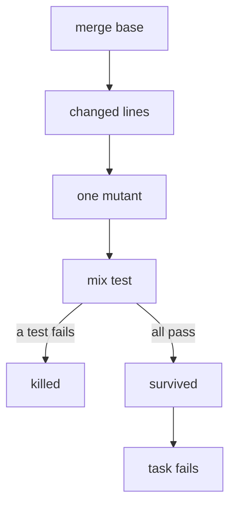

> [!TLDR]
> Line coverage counts a line as tested once it runs, even if no test would fail when it changes. Mutation testing checks that by changing the code and rerunning the tests. On our app, with 96% coverage, it found 17 changes on one branch that no test caught. It is slow, so I run it only on the lines a branch changed, against tests that skip the web layer.

Our Phoenix app gates its line coverage at 96% with [Six](https://hex.pm/packages/six). One of its functions works out an age from two dates. When its `-` became a `+`, every test still passed. Coverage said that line was tested. No test checked its answer.

## How a mutant survives

[Muex](https://hex.pm/packages/muex) is a mutation testing tool for Elixir. It makes a mutant: a copy of the code with one small change, such as that `-` to a `+`. Then it reruns the tests. If a test fails, the mutant is killed. If every test passes, the mutant survives, and a survivor is a line no test really checks.

Some mutants can't be killed. An equivalent mutant behaves the same as the original, so no test can tell them apart. `Muex` spots some of these and leaves them out.

## Mutate only changed lines

Each mutant is its own recompile and test run. On one module of business rules, a full run that kept every mutant made hundreds and took a quarter of an hour. That is too slow to run on every branch.

So I only mutate what the branch changed. `Muex`'s `--since` option mutates only the lines changed after a commit. I give it the commit where the branch left `master`, and fail the run on any survivor. On a small commit that takes seconds.



## Run only fast tests

Each mutant also reruns every test that depends on the module it changed. A test that renders a PDF or drives a LiveView runs once per mutant, and that cost multiplies. So I tag the slow tests with `@moduletag :slow` and exclude them from the run.

That has a useful side effect. A business rule that only a slow test checks now shows up as a survivor. Each one is a rule that needs a fast test of its own.

## What the survivors taught

Fourteen of the 17 survivors needed a sharper test. The age had no test on a birthday boundary. A median passed because every test score was the same, so any middle pick matched. Logic that only a web test reached moved into a function a fast test could call.

The rest needed code changes. Two guards repeated a check the code already made, so no test could ever fail them. I deleted one and narrowed the other. A step that rendered a PDF became an argument with the real renderer as its default, so a fast test can pass a stub:

```elixir {filename="lib/my_app/docs.ex"}
def download(scope, id, draw \\ &render_pdf/2) do
  doc = get!(scope, id)
  {:ok, pdf} = draw.(scope, doc)
  record_download(scope, doc, pdf)
end
```

## Where Muex falls short

A whole branch still takes minutes and pegs my machine, so it's too slow for CI or the local gate. I run it by hand before review. `Muex` 0.12 also can't mark an equivalent mutant it misses as ignored: it stays a survivor until you change the code around it.

## Keep the coverage gate

Coverage still gates CI. `Muex` answers the question coverage can't: would any test fail if this line were wrong? In exchange, the fast tests have to stay fast. It works well where fast unit tests can reach the code, and poorly where only integration or end-to-end tests do, through the web layer or an API.
