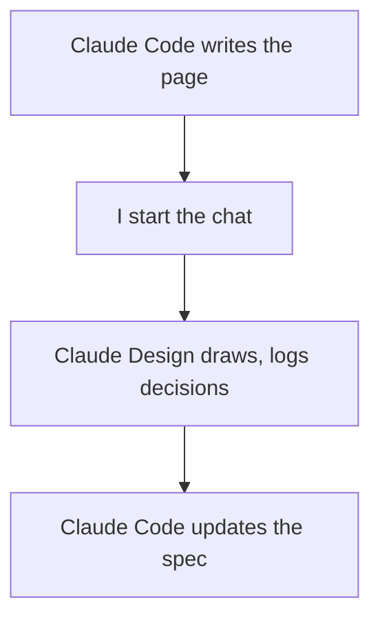
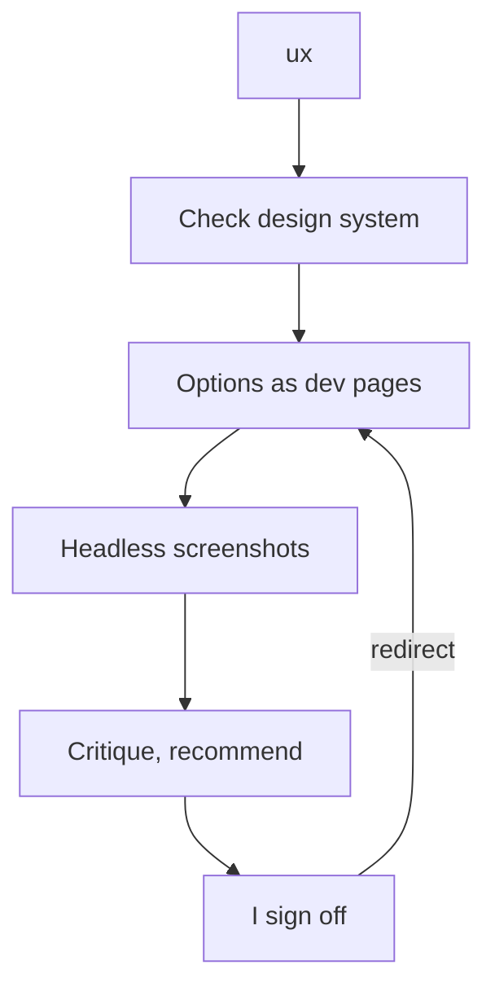

> [!TLDR]
> On projects without a full-time designer, Claude Design can help cover some bases. In my setup, Claude Code can't start or message its chat. So I carried each round in as a zip and pasted the replies back out. Nobody worked in the canvas, so keeping it current was overhead. Now Claude Code builds design options as pages in the running app. It recommends one and waits for my sign-off.

We're building a [Phoenix LiveView](https://hexdocs.pm/phoenix_live_view/) app with Claude Code, without a full-time designer. My part is getting each screen change designed before it's built. [Claude Design](https://claude.ai/design) looked like it could cover that. It is a canvas of boards, with a chat that draws on them.

## Why the canvas needed me

As far as I know, Claude Code can't start or message a Claude Design chat. The two share files: the canvas and a copy of the design system. So getting work in meant a zip. Claude Code packed the specs (the GitHub issues that describe each change), the design tokens (the colour, spacing and type values), 60 screenshots and a list of prompts. I uploaded it and pasted the prompts in one at a time. Getting work out meant me as well: in one session I pasted Claude Design's replies into Claude Code twice in ten minutes.

To cut the relay, Claude Code wrote a canvas page for each piece of work, with skills (sets of instructions Claude Code loads for one kind of job). The page held the screens as they are today and a brief for the change. I still started each round:



A team with a designer would keep a library of every screen, in [Figma](https://www.figma.com) or in code with a component catalogue such as [Storybook](https://storybook.js.org). I kept one on the canvas for a while, and keeping it in sync felt like a fool's errand. Nobody sits in the canvas owning those boards, and the code moves faster than they do. So Claude Code drew the current screens fresh from the code for each piece of work, and the canvas was overhead nobody used.

## Design in the app

I wanted Claude Code to design in the app, show me options and stop only for my call. Skipping the design step isn't the answer, even for a small fix. One that wrapped a row of links reached review with no screenshots, and it looked broken on a phone.

So I built a `ux` skill on [`impeccable`](https://github.com/pbakaus/impeccable), a design skill that works on the real components and data. `ux` calls it for two steps only, framing the options and critiquing the one it recommends. A run that used it throughout scored no better with a blind judge, on half again the tokens.

## Build options as dev pages

Claude Code runs `ux` when an issue changes a screen. It:

1. checks the design system for a pattern that already fits
2. runs `impeccable`'s `shape` step, which frames the problem and the options
3. builds each option as a development-only page, or behind a development-only switch on the real screen
4. screenshots each in a headless browser (one with no window): phone, tablet and desktop, light and dark
5. picks one, critiques it with `impeccable`, and recommends it

Then it posts its recommendation on the issue and stops:

```text
Recommend A: <why>. Tradeoff: <what A gives up>.
A: http://localhost:<port>/dev/ux/<issue>/a
B: http://localhost:<port>/dev/ux/<issue>/b
Sign off, or redirect.
```

Each page has a switcher to the others. Claude Code builds once I sign off. A UI fix goes through `ux` too, however small; it can come down to one option and its screenshots.



## When the canvas still fits

A large new flow has many screens, and a canvas page shows them together. I'd keep the canvas skills for that.
