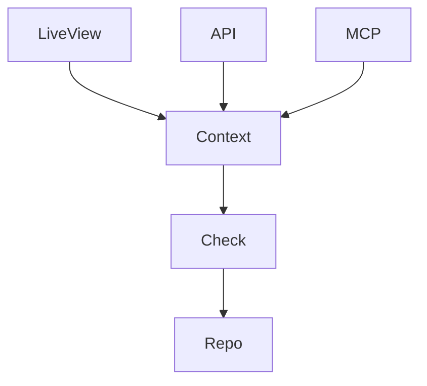

> [!TLDR]
> Phoenix 1.8 gives you a `%Scope{}` that says who is calling. Pass it first to almost every public context function, and check permissions there. Then a LiveView, a controller, a REST or GraphQL API and an MCP server all get the same checks.

## Where the check goes missing

Say a LiveView lets you delete your own posts. The check that it's yours sits in the LiveView:

```elixir {filename="lib/app_web/live/post_live/index.ex"}
def handle_event("delete", %{"id" => id}, socket) do
  post = Posts.get_post!(id)

  true = post.user_id == socket.assigns.current_scope.user.id
  {:ok, _} = Posts.delete_post(post)

  {:noreply, stream_delete(socket, :posts, post)}
end
```

Then you add an API that deletes posts too:

```elixir {filename="lib/app_web/controllers/api/post_controller.ex"}
def delete(conn, %{"id" => id}) do
  post = Posts.get_post!(id)
  {:ok, _} = Posts.delete_post(post)

  send_resp(conn, :no_content, "")
end
```

Nothing in `Posts` asks whose post it is, and the API doesn't either. So any API client can delete anyone's post. Each new interface has to copy the check, and an MCP tool (an action an AI agent can call) added later is one more place to miss it.

## Check it in the context

Phoenix 1.8's generators pass a [`%Scope{}`](https://hexdocs.pm/phoenix/scopes.html) first to context functions. The scope holds the current user, so `get_post!(scope, id)` finds only that user's posts. The generated delete checks the owner itself:

```elixir {filename="lib/app/posts.ex"}
def delete_post(%Scope{} = scope, %Post{} = post) do
  true = post.user_id == scope.user.id

  Repo.delete(post)
end
```

The `true =` match crashes the call when the post isn't yours. The LiveView and the API now call the same function, each with its own scope:

```elixir {filename="lib/app_web/live/post_live/index.ex"}
Posts.delete_post(socket.assigns.current_scope, post)
```

```elixir {filename="lib/app_web/controllers/api/post_controller.ex"}
Posts.delete_post(conn.assigns.current_scope, post)
```

That's just good design. No interface can skip the check, and one added later gets it too:



## Build a scope per interface

`phx.gen.auth` builds the scope in a plug for controllers, and in `on_mount` for LiveViews. A REST or GraphQL API, or an MCP server, builds one from the caller's API token before it calls a context. That's [ports and adapters](https://alistair.cockburn.us/hexagonal-architecture/): the contexts are the core, and each interface is an adapter that builds a scope and calls them. I think the context API trusts the scope it's given, so callers need to make sure the scope is good.

Once every context function takes the scope, the scope is also the place for anything else about the caller. In a client's Phoenix app it carries the request ID. So each audit event records which request caused it, and no caller passes the ID.

## Write down the exceptions

(Almost) all public functions take the scope. The exceptions are functions whose result doesn't depend on who's asking, such as one that formats a date. Write the list down where the team will find it, so code review can enforce it.

## When scope-first fits

Moving an existing app to it is a wide diff, since context signatures and their callers change. Only review enforces it, because no check in `credo`, Elixir's linter, catches a public function without a scope. A policy library such as [Bodyguard](https://hexdocs.pm/bodyguard) works with it: its policy modules hold the checks, and the context calls them with the scope.

Scope-first fits an app where more than one interface calls the same contexts. The generators already do it for the functions they write. The work is keeping it up in the ones you write by hand.
