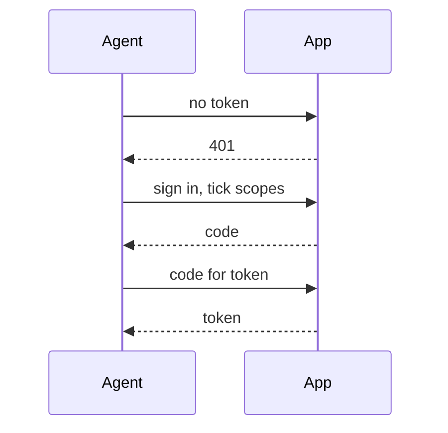
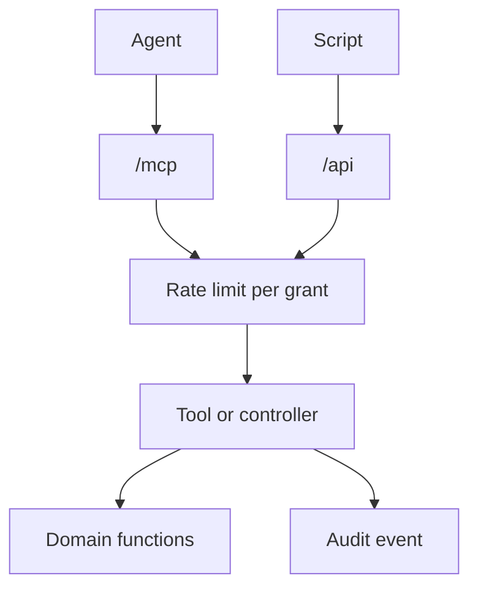

> [!TLDR]
> We wanted AI agents to read and update records in our app. Claude
> and other agents have MCP built in, so I built an MCP server first. It shares its token check, audit and rate limit with the rest
> of the app. So when a script needed REST, that took one controller and a
> list of request checks.

## An API for agents

We wanted a feature that let AI agents work with our
[Phoenix](https://www.phoenixframework.org/) app: find records, read one, and
update it. An admin of the app still decides what gets published.

The brief asked for an API that agents could call over MCP, REST or both, and
an auditable one. Both transports means two endpoints to secure. So which do you
build first?

## Why MCP came first

[MCP](https://modelcontextprotocol.io/) (Model Context Protocol) is how Claude
and other LLM (large language model) agents call tools on a server. Take an agent in
[`Claude Code`](https://code.claude.com/docs/en/mcp). It lists the app's
tools, reads that `list_records` finds records, and calls it. Then it calls
`get_record` and `update_record`. The agent needs no URLs: Claude has an MCP
client built in.

With REST, the agent's instructions carry the endpoints, and it calls them with `curl`. I'd consider an MCP server, not a REST API,
given the client will be an LLM agent.

Another option is a REST API with an MCP server on top, as
[Stripe does](https://docs.stripe.com/mcp). This app had no REST API to wrap.
So I wrote down when REST would come: the first caller with no MCP client.

## OAuth instead of API keys

An API key in the agent's config is the simple way in. Unless narrowed, it can do anything the admin can, publishing included, until someone deletes it.

The
[MCP authorization spec](https://modelcontextprotocol.io/specification/2025-06-18/basic/authorization)
uses OAuth 2.1 instead. An authorization server asks the admin to approve the agent, then gives it a limited token. I built that server into
the app. In an MCP client such as `Claude Code`, the admin adds the server,
then runs `/mcp` to sign in. On the sign-in page the admin ticks the scopes, the permissions this
agent gets:

```sh
claude mcp add --transport http --client-id my-app-cli my-app https://app.example.com/mcp
```



The approval is a grant. Its token acts for that admin alone, and the MCP server
refuses a tool whose scope the grant lacks. Revoking a grant stops it at once.

## Why the app issues tokens

A hosted provider such as
[WorkOS AuthKit](https://workos.com/docs/authkit/mcp) can also do MCP auth. I
counted that as a second set of users to keep in step with the app's admins.
[Boruta](https://hex.pm/packages/boruta) is an Elixir OAuth server library. It brings OpenID Connect, which the app doesn't need.

The app's own server does the authorization code flow with PKCE, nothing
more. PKCE is a one-time secret that stops a stolen code being swapped for a
token. Removing an admin's role revokes their grants in the same transaction.

## No publishing for agents

An agent can never publish (yet), so there is no publish scope and no tool for
it. The app's authorization policy says which role may do what. It also
refuses agents publishing. The app's domain functions check it, so a later
tool gets refused too.

## Audit in each tool

For the auditable API, each tool calls `Agents.record_call`. It writes an audit event naming the tool, the grant and any record. `scope` (not an OAuth scope) holds who is acting: the admin, through this grant. `Records.find_record` is the same
domain function the admin pages call:

```elixir {filename="lib/my_app_web/agent/get_record.ex"}
def execute(%{record: id}, frame) do
  grant = MyAppWeb.Agent.grant(frame)
  scope = MyAppWeb.Agent.scope(frame)

  case Records.find_record(scope, id) do
    nil ->
      :ok = Agents.record_call(scope, grant, "get_record", id)
      {:reply, Response.error(Response.tool(), "not_found: no record #{id}"), frame}

    record ->
      :ok = Agents.record_call(scope, grant, "get_record", record)
      # result/1 builds the JSON map the agent gets back
      {:reply, Response.structured(Response.tool(), result(record)), frame}
  end
end
```

Whoever writes a new tool has to add that call. A plug, a function each
request passes through, could audit each request instead. But the tool
already holds the record it found.

## A script gets REST

A script also needed to load a reference table, and a script has no MCP client. A plain `GET` and `PUT` is simpler to write with `curl` than MCP's messages. So the table got one REST controller,
at `/api`. It calls the same domain functions.

## Checks both endpoints share

An agent stuck in a loop can flood the app, so each grant gets a rate limit. If that limit lived in the MCP server, the script's requests to
`/api` would skip it. In Phoenix, a router pipeline is a list of plugs a route
runs. So one rate-limit plug sits in both, counting requests per grant. Over the limit, it answers HTTP 429 with
`Retry-After`.

The MCP server checks each token itself. For REST, the `Authenticate` plug
calls that same check, so REST needed no new auth:

```elixir {filename="lib/my_app_web/router.ex"}
pipeline :mcp do
  plug MyAppWeb.Agent.RateLimit
end

pipeline :agent_api do
  plug MyAppWeb.Agent.RateLimit
  plug MyAppWeb.Agent.Authenticate
end
```



## When MCP first fits

MCP first fit this app because its callers were agents with an MCP client,
and there was no REST API to wrap. With the checks shared, REST took one pipeline and
one controller. With an existing REST API, I'd put an MCP server on top.
