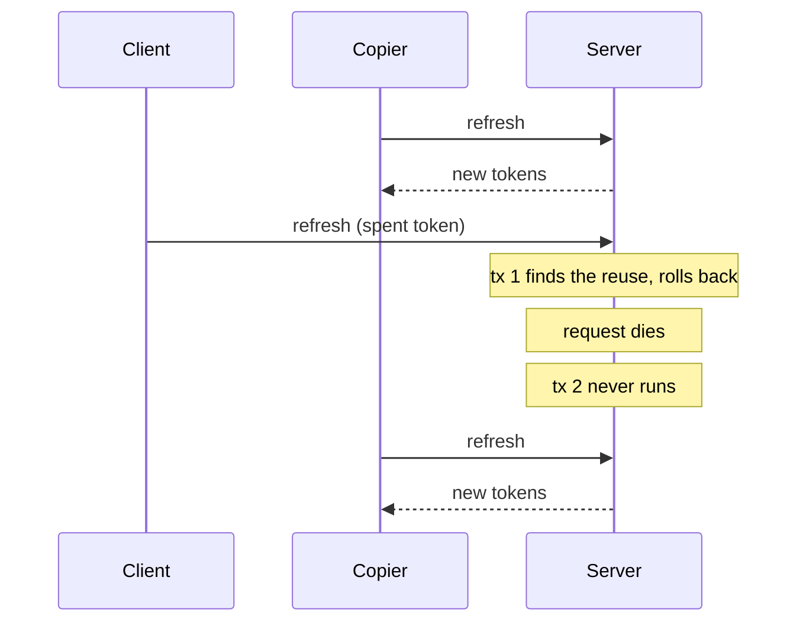

> [!TLDR]
> When a spent refresh token comes back, the server ends the grant it
> belongs to. This code found the reuse in one transaction and revoked in a second, so a
> request that died between the two lost the revoke.
> None of the example tests killed a request at that point. A TLA+ model with
> one action for "the request dies" did, and broke the rule in about a second.
> The revoke now commits in the transaction that finds the reuse, and a test
> of the queries pins it.

## Two transactions, one revoke

Take an OAuth grant that lets an AI agent act for an admin. The agent [signs
in with OAuth](/posts/mcp-before-rest-when-the-caller-is-an-agent/), and each
refresh hands it a new refresh token and spends the old one. So a spent token
that comes back means someone has a copy.
[RFC 9700](https://www.rfc-editor.org/rfc/rfc9700#section-4.14.2) (OAuth's
current security advice) says the server can't tell who sent it, so it
"will revoke the active refresh token". The owner and the thief both lose the
grant.

The token endpoint is `exchange/3`. It runs `swap/2`, which looks the grant
up under a `FOR UPDATE` row lock and checks the token. When `swap/2` finds a
reuse, it returns `{:error, {reason, grant}}`. Here is what `exchange/3` did
with that:

```elixir
def exchange(scope, params, now \\ DateTime.utc_now()) do
  case Repo.transact(fn -> swap(params, now) end) do
    {:error, {reason, %Grant{} = grant}} ->
      {:ok, _grant} = end_grant(grant, scope, reason, now)
      {:error, "invalid_grant"}

    result ->
      result
  end
end
```

An error from the function rolls a `Repo.transact/1` back, so the reuse is
found, the transaction is thrown away, and only then does `end_grant/4` open
a second transaction to revoke. A deploy or a dropped database connection
between those two transactions would leave the grant live, and whoever
refreshed first, owner or copier, would keep it until it lapsed.

## Why add a model?

The code already had static analysis and tests, and neither was going to
find this. Static analysis checks what the code says: types, calls, what can
reach what. A test checks one order of events, the one its author wrote
down. None of the reuse tests killed a request between the two transactions.

A model checker searches the orders instead. You describe the system as a
few variables and the actions that change them, write down the rules it
must keep, and the checker tries every action in every order and reports
the first path that breaks a rule. That's a search, not a proof: it covers
every state up to the bounds you set, and nothing past them. (TLA+ also has
a [proof system](https://proofs.tlapl.us/) for when bounds aren't enough.)

It's worth adding where the rules are few and the orders are many: tokens,
locks, retries, queues, anything two parties or a crash can interleave.
For a form or a report, a test of each case is enough.

## A model of one grant

I wrote a [TLA+](https://lamport.azurewebsites.net/tla/tla.html) model
of the token endpoint, checked with TLC, its model checker.

The model holds one grant and two parties: the client, and a copier. Tokens
are numbered, so "the current refresh token" is a number, and spending it
means issuing the next one. Each action stands for one indivisible step in
the code. A refresh looks like this:

```tla
SwapRefresh(p) ==
  \E t \in holds[p] :
    /\ t.k = "refresh"
    /\ IF t.n = refresh THEN Live /\ Issue(p, t)
       ELSE IF t.n = previous /\ inGrace THEN FALSE  \* refused, nothing written
       ELSE FindReuse
```

Party `p` presents a refresh token it holds. The current one gets new tokens
if the grant is live. Any other token is a reuse, with one exception: the
token spent just before the current one, inside a grace of about a minute.
Two sessions sharing one credential both refresh when the access token
expires, and the loser presents the token the winner just spent. Inside the
grace the server refuses it with `invalid_grant` and write nothing, and the loser
retries with the winner's new token.

The model has no clock. Each thing a clock ends (the grace, the access
token, the grant itself) is an action that can happen at any moment, so TLC
tries it at every moment. The copier gets one action too, `Copy`, which takes
whatever the client holds once, say a code caught in transit or a
credentials file that got out.

The model has four rules. Three are invariants, checked in every state: an
ended grant never answers, a spent token never gets new tokens, and after a
copy only one party ever refreshes. The fourth is the one that broke.

## Let the request die

The model mirrored the two transactions. Finding a reuse and revoking were
two actions, with a counter, `ending`, for reuses waiting on their revoke.
A third action let a waiting request die:

```tla
FindReuse ==                \* tx 1 saw a reuse and rolled back
  /\ ending < 2
  /\ ending' = ending + 1
  \* ...every other variable unchanged

EndReused ==                \* tx 2: end_grant/4 revokes
  /\ ending > 0
  /\ ending' = ending - 1 /\ revoked' = TRUE
  \* ...every other variable unchanged

RequestDies ==              \* the request dies between the two
  /\ RequestsCanDie /\ ending > 0
  /\ ending' = ending - 1
  \* ...every other variable unchanged

ReuseEndsGrant == (ending > 0) ~> revoked
```

`~>` reads "leads to": whenever a reuse is waiting, the grant must be revoked
at some later point. That makes it a liveness rule, about what must happen
eventually, where an invariant is about what must hold in every state.
`RequestsCanDie` is a constant in the config, so the death action can be
switched off. With it on, TLC answers:

```text
Error: Temporal properties were violated.
Error: The following behavior constitutes a counter-example:
```

It follows that with a path that ends in a loop where `revoked` stays
`FALSE` forever. The plainest path to that state runs like this:

1. The client swaps its one-time code for its first tokens.
2. The copier takes a snapshot of them.
3. The copier refreshes first, so the client's refresh token is now spent.
4. After the grace, the client refreshes with that spent token, and the
   server finds the reuse.
5. The request dies before the second transaction revokes.



The client would get an error, and the copier would keep a working grant
until it lapsed.

## Revoke where you found it

The fix moves the revoke inside the transaction that found the reuse, under
the same row lock:

```elixir
def exchange(scope, params, now \\ DateTime.utc_now()) do
  fn ->
    with {:error, {reason, %Grant{} = grant}} <- swap(params, now) do
      {:ok, _grant} = Grants.end_grant(grant, scope, reason, now)
      {:ok, :reused}
    end
  end
  |> Audit.transact()
  |> case do
    {:ok, :reused} -> {:error, "invalid_grant"}
    result -> result
  end
end
```

The trick is the `{:ok, :reused}`. The reuse branch returns success from
inside the transaction, so the revoke commits instead of rolling back, and
only after the commit does it turn into the client's `invalid_grant`.
`Audit.transact/1` wraps `Repo.transact/1`. If the request dies now,
Postgres throws away the check and the revoke together, and the next refresh
with that token finds the reuse again.

The model changed the same way. Finding the reuse revokes in the same
action, and a request that dies changes nothing, because its one
transaction rolls back whole:

```tla
FindReuse ==
  /\ reused' = TRUE /\ revoked' = TRUE
  \* ...every other variable unchanged

RequestDies == RequestsCanDie /\ UNCHANGED vars

ReuseEndsGrant == reused ~> revoked
```

The config now runs with the deaths switched on, and TLC checks every path
up to four successful swaps in about a second, at about 600 distinct states:

```text
CONSTANTS
  MaxSwaps = 4
  RequestsCanDie = TRUE
```

## Pin the queries

That new `FindReuse` holds by construction. When finding a reuse and
revoking are one action, "reuse ends the grant" can't fail, so a green
model says nothing about the code. What ties the two together is a test of
the queries a reuse runs. It listens to Ecto's query telemetry during a
refresh with a spent token, keeps the transaction markers and the revoke,
and expects one transaction:

```elixir
:ok = :telemetry.attach(id, [:my_app, :repo, :query], &__MODULE__.on_query/4, self())
on_exit(fn -> :telemetry.detach(id) end)

assert {:error, "invalid_grant"} = refresh(first.refresh_token, past_grace())
:telemetry.detach(id)
# queries: every statement the refresh sent, in order

steps =
  Enum.flat_map(queries, fn
    query when query in ["begin", "commit", "rollback"] -> [query]
    query -> if query =~ ~r/^UPDATE "grants" SET .*"revoked_at"/, do: ["revoke"], else: []
  end)

assert steps == ["begin", "revoke", "commit"], inspect(queries, pretty: true)
```

On the old code it saw `begin`, `rollback`, then a second `begin`, the
revoke and `commit`, and failed. An outcome test (is the grant revoked?)
passes on both versions, so it has to be the queries.

## What the model is for

The model is small, and that is also its limit. A bounded model proves
nothing past its bounds, and it checks the model, not the Elixir, so each
action is only as true as my reading of the code it stands for.

The model has "the request dies" as an action, so TLC tried it after every
other step, and that's how it found this. The next change to the token
rules gets checked the same way, in case a new action splits something that
has to commit together.

The same bug can sit in any handler that finds something in one transaction
and acts on it in a second: a detected reuse, a fraud flag, a lockout after
too many attempts. If a rollback sits between the two, check what happens
when the request dies there. A model checks that in every order, and a test
of the queries keeps it fixed.
