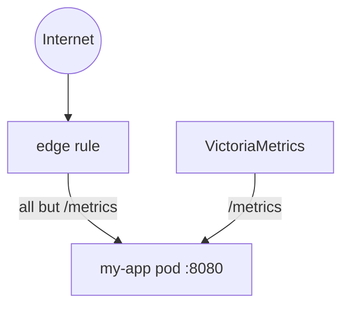

> [!TLDR]
> If [PromEx](https://github.com/akoutmos/prom_ex) serves `/metrics` from your Phoenix endpoint, keep it off the internet with a rule on the load balancer, not an ingress-nginx snippet. A separate metrics port avoids the rule altogether, but needs an app change.

[Bramble](https://www.brmbl.io) is a Phoenix LiveView app on Kubernetes, and PromEx feeds its Grafana dashboards. Those metrics are served on the same port as the app, so where do you stop the internet reading them?

## PromEx shares the app's port

PromEx can serve metrics from a plug in the Phoenix endpoint, or from a separate metrics port. We use the plug:

```elixir {filename="lib/my_app_web/endpoint.ex"}
  plug PromEx.Plug, prom_ex_module: MyApp.PromEx
```

```elixir {filename="config/runtime.exs"}
config :my_app, MyApp.PromEx,
  # ...
  metrics_server: :disabled
```

So `/metrics` answers on the app's HTTP port (8080 for us), the port every public request reaches. [PromEx's Security Concerns](https://prom-ex.hexdocs.pm/readme.html#security-concerns) warn against exposing it, and suggest blocking it at "a load balancer or an API gateway", or guarding the plug itself. We block it in front of the app, and I'll call that the edge rule.

[VictoriaMetrics](https://victoriametrics.com/) scrapes 8080 from inside the cluster, so the edge rule never gets in its way.



## A snippet on the ingress

Our first edge rule was an `nginx.ingress.kubernetes.io/server-snippet` [annotation](https://kubernetes.github.io/ingress-nginx/user-guide/nginx-configuration/annotations/#server-snippet), added to every app Ingress by our shared Pulumi helper:

```typescript
annotations: {
  "nginx.ingress.kubernetes.io/server-snippet": `
    location ~* "/metrics" {
      deny all;
      return 403;
    }
  `,
},
```

That has two problems:

1. A snippet is raw nginx config, and snippets are the attack vector in [CVE-2021-25742](https://github.com/kubernetes/ingress-nginx/issues/7837): whoever can write an Ingress can read the controller's secrets. ingress-nginx [turned snippet annotations off by default](https://kubernetes.github.io/ingress-nginx/user-guide/nginx-configuration/configmap/) from v1.9.0. To use one now, you turn `allow-snippet-annotations` back on. You also raise `annotations-risk-level`, the most dangerous annotation the controller accepts, to `Critical`. That reopens the hole.
2. It ties the rule to ingress-nginx, which Kubernetes is [retiring](https://kubernetes.io/blog/2025/11/11/ingress-nginx-retirement/).

## Block at the load balancer

We'd already moved the edge rule to our AWS Application Load Balancer, as defence in depth that needed no app change, before the retirement was announced. It answers `/metrics` with a fixed 403 before the request reaches the cluster.

It matches the path exactly, where the nginx regex matched `/metrics` anywhere in the path. [`PromEx.Plug`](https://github.com/akoutmos/prom_ex/blob/master/lib/prom_ex/plug.ex) also only answers on the exact path, so `/metrics/` or `/Metrics` gets past the rule and lands on the app's router instead.

## Port or edge rule?

The separate metrics port avoids the edge rule altogether. Drop the plug from the endpoint, give PromEx its own [`metrics_server`](https://prom-ex.hexdocs.pm/PromEx.Config.html), point the scrape at that port, and leave it out of the Service, so no load balancer route leads to it:

```elixir {filename="config/runtime.exs"}
config :my_app, MyApp.PromEx,
  # ...
  metrics_server: [port: 4021, path: "/metrics"]
```

Reach for the edge rule when:

- you'd rather not change the app
- your load balancer already holds the rest of your edge rules

Reach for the separate metrics port when:

- you can't be sure every route into the app goes through the same load balancer
- the people who change the load balancer aren't the people who add metrics

We kept the plug and the edge rule. If I were starting again, I'd try the separate metrics port first, so a new route into the app can't expose the metrics.
