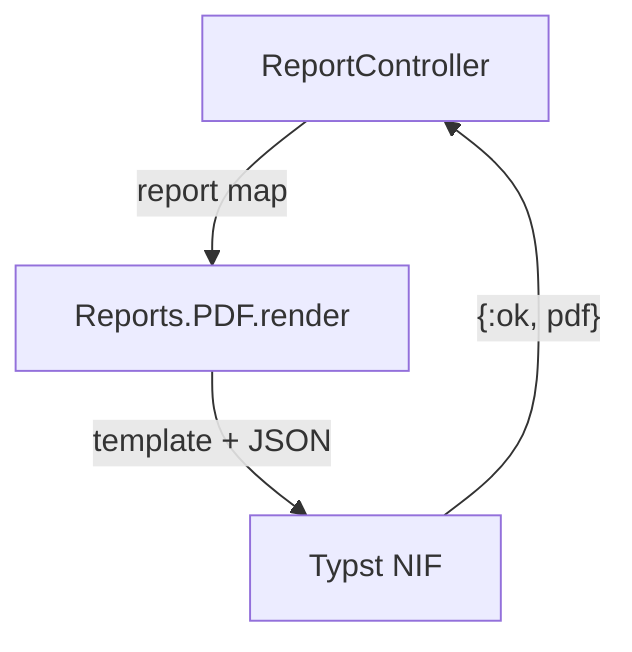

<!-- vale House.ClientNumbers = NO -->

> [!TLDR]
> We render our Phoenix app's report PDFs inside the Erlang VM (the BEAM), with the [`typst`](https://hex.pm/packages/typst) hex package. It wraps Typst, a typesetting language, in a NIF (native code that runs inside the VM). On my desktop a 10-page report takes 10 ms, 5x faster than the Typst CLI. A slow render runs on a separate thread pool, so the app's processes keep running. Other renders can still queue behind it. Report data goes in as JSON, so member input never becomes markup.

<!-- vale House.ClientNumbers = YES -->

Our app lets a member download their report as a PDF. It's a designed, 10-page report. The app runs on a small server, and we wanted nothing extra installed there.

[`ChromicPDF`](https://hexdocs.pm/chromic_pdf/ChromicPDF.html) prints HTML with a headless browser. The [Typst](https://typst.app) CLI can run as a port (a separate OS process the VM talks to), or the Typst compiler can load into the VM as a NIF. Our stack rule allows a NIF, which can crash the VM, only for a well-tested library, and the `typst` package wraps the Typst compiler in one.

## Choose Typst over headless Chrome

`ChromicPDF` reuses the app's HEEx templates (Phoenix's HTML templates) and print CSS, and needs a Chrome to talk to, in the image or as a service, plus one in CI. [`WeasyPrint`](https://weasyprint.org/) needs a Python stack, and [`Gotenberg`](https://gotenberg.dev/) runs as a service beside the app, so each adds something to run.

Typst can draw the report's design without HTML, and the package's NIF is precompiled, so there's no binary to install.

The tradeoff is that the layout exists twice, in HEEx for the web and in a `.typ` template for the PDF.

## Render the PDF on request

A member clicks Download. The controller loads the report and passes its data to `Reports.PDF.render/1`, which returns the PDF:

```elixir {filename="lib/my_app_web/controllers/report_controller.ex"}
defmodule MyAppWeb.ReportController do
  use MyAppWeb, :controller
  alias MyApp.Reports

  def download(conn, %{"id" => id}) do
    report = Reports.get_report!(conn.assigns.current_scope, id)
    {:ok, pdf} = Reports.PDF.render(Reports.pdf_data(report))
    send_download(conn, {:binary, pdf}, filename: "report.pdf", content_type: "application/pdf")
  end
end
```

Inside, `render/1` encodes the map as JSON and calls the NIF:



## Pass the data as JSON

Say a member enters `#set page(fill: red)` as their name. In Typst markup, that line colours the page. `Typst.render_to_pdf/3` runs the markup through `EEx` (Elixir's built-in templating) first. The package's docs pass data as bindings, values `EEx` pastes into the markup. `render_to_string` shows the result:

```elixir
Typst.render_to_string("<%= name %>\n= Report for a member", name: "#set page(fill: red)")
#=> "#set page(fill: red)\n= Report for a member"
```

That member's report comes out red. So `render/1` passes no bindings, and hands the data over as a file in `:assets`:

```elixir {filename="lib/my_app/reports/pdf.ex"}
defmodule MyApp.Reports.PDF do
  def render(data) do
    priv = Application.app_dir(:my_app, "priv")

    Typst.render_to_pdf(File.read!(Path.join(priv, "typst/report.typ")), [],
      root_dir: priv,
      extra_fonts: [Path.join(priv, "typst/fonts")],
      assets: ["data.json": JSON.encode!(data)]
    )
  end
end
```

The template reads that file with `json()`. Typst sets a string from JSON as plain text, so the same name prints as `#set page(fill: red)` on a white page:

```typst {filename="priv/typst/report.typ"}
#let data = json("data.json")
= Report for #data.name
```

## Benchmark NIF against CLI

I rendered the same 10-page report with the NIF and with the Typst CLI as a port, using [`Benchee`](https://github.com/bencheeorg/benchee), and read RSS (memory held in RAM) from `/proc`. A third case runs the CLI with its default scan of every installed font. On my desktop (Ryzen 7 5800X, the `typst` package 0.4.5, the Typst CLI 0.15.1):

```text
Name                        ips        average  deviation         median         99th %
NIF                       97.18       10.29 ms    ±14.87%        9.89 ms       15.74 ms
CLI                       18.75       53.32 ms    ±10.87%       51.60 ms       77.76 ms
CLI, system fonts          4.57      218.81 ms     ±7.00%      213.76 ms      297.26 ms
```

<!-- vale House.ClientNumbers = NO -->

The NIF's median render took 10 ms, against 52 ms for the CLI. The VM's RSS rose by about 32 MB on the first render and another 4 MB over the benchmark. One CLI render peaked near 32 MB too, in a fresh process that frees it on exit. The font scan took the CLI's median to 214 ms.

<!-- vale House.ClientNumbers = YES -->

## Check the NIF's safety

The VM runs your processes on scheduler threads, by default one per logical CPU. A plain NIF runs on the calling scheduler thread. If a render held that thread for a second, the processes queued on it would wait. If it crashed, the VM would go down. Before adding a NIF, check its source and build for these:

1. The package's NIFs are marked `schedule = "DirtyCpu"`, so the VM runs them on dirty CPU schedulers, a separate pool of the same size.
2. The Rust crate doesn't set `panic = "abort"`, so [`Rustler`](https://github.com/rusterlium/rustler), which binds Rust as NIFs, can turn a Rust panic into an exception in the caller. We haven't seen one.
3. The NIF's `.so` links only `libc`, `libm`, `libgcc_s` and the dynamic loader, which a slim Debian image already has.
4. [`rustler_precompiled`](https://hexdocs.pm/rustler_precompiled) downloads the NIF during `mix deps.compile`. It checks the sha256 against a checksum file in the hex package, and `mix.lock` pins that package.

A template typo or malformed data comes back as an error value. The controller's `{:ok, pdf}` match fails, so that download gets a 500. The next render works:

```elixir
Typst.render_to_pdf("#let x = (", [])
#=> {:error, "[line 1:10] unclosed delimiter\n  Source: #let x = (\n                   ^"}

Typst.render_to_pdf(~S|#json("d.json")|, [], assets: ["d.json": "{not json"])
#=> {:error, "Error: failed to parse JSON (key must be a string at line 1 column 2)"}

match?({:ok, "%PDF-" <> _}, Typst.render_to_pdf("still here", []))
#=> true
```

## Plan for the NIF's limits

The NIF has no timeout. Typst stops a `while` loop that looks infinite. A slow render still ties up a dirty scheduler, and you can't kill a NIF mid-call. On a one-CPU machine the VM starts one dirty CPU scheduler, so other renders queue behind it.

`Rustler` catches a panic, but not an abort or a native stack overflow. Either takes the VM down.

An `#import "@preview/..."` makes the NIF fetch that package from `packages.typst.org` at render time, unless already cached locally. The app's template imports none.

## NIF, port or Chrome?

I'd take a NIF that runs on a dirty scheduler, can catch a panic, and downloads against a checksum. This one does, and the app needs nothing installed beside it. If your PDF must match your HTML and you can ship a browser, `ChromicPDF` is the shorter path. If a render needs a timeout, or a native crash must not take down the VM, run the Typst CLI as a port.
