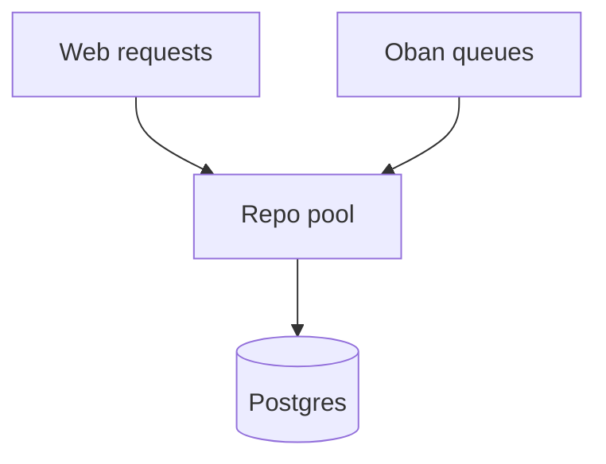

> [!TLDR]
> This page is a draft, so it only renders under `hugo server -D`. It shows
> every block a post can use, so a theme change can be checked on one page.

The body text runs at the prose width. Inline code such as `mix test` keeps
its backticks. A [link to Oban](https://hexdocs.pm/oban) takes the accent.

## Callouts

A callout is a GitHub alert. Use one per section at most.

> [!NOTE]
> Oban stores every job as a row in `oban_jobs`.

A tip:

> [!TIP]
> Prune finished jobs with the `Pruner` plugin.

A warning:

> [!WARNING]
> Every running job can hold a database connection.

A caution:

> [!CAUTION]
> A migration on the job table locks it while it runs.

## Asides

An aside is a tangent the reader can skip. It sits by the line it belongs to.


Oban calls the plugin that rescues orphaned jobs `Lifeline`. It runs on the
leader node only.


The paragraph after an aside picks the main line back up.

## Figures

A diagram with a caption goes in the `fig` shortcode.







A code block can take a caption too.



```elixir {filename="lib/my_app/orders.ex"}
Ecto.Multi.new()
|> Ecto.Multi.insert(:order, order_changeset)
|> Oban.insert(:receipt, fn %{order: order} ->
  MyApp.Workers.SendReceipt.new(%{order_id: order.id})
end)
|> MyApp.Repo.transaction()
```



## Comparisons

Two versions side by side, stacked on a phone.




```elixir
Repo.insert!(order)
Oban.insert!(job)
```

The job survives a failed order.



```elixir
Multi.new()
|> Multi.insert(:order, cs)
|> Oban.insert(:job, job)
```

Both commit, or neither does.



## Code

A diff shows what changed.

```diff
 config :my_app, Oban,
-  queues: [default: 50]
+  queues: [default: 10, mailers: 5]
```

## Tables

| Plugin | What it does |
| :-- | :-- |
| `Pruner` | Deletes finished jobs |
| `Lifeline` | Rescues orphaned jobs |
